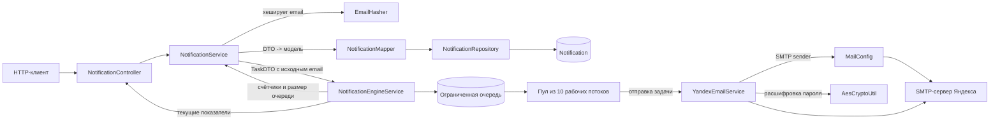
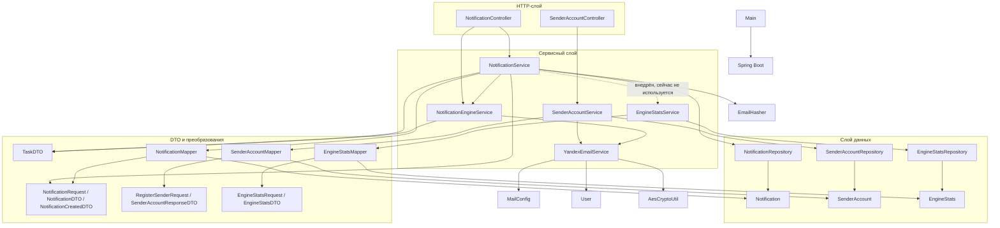

# High-Throughput Notification Engine

## Структура проекта

```text
app/
├── build.gradle.kts
└── src/
    ├── main/
    │   ├── java/
    │   │   ├── standart/code/
    │   │   │   ├── Main.java
    │   │   │   ├── config/       # Настройка SMTP
    │   │   │   ├── constant/     # Константы API-маршрутов
    │   │   │   ├── controller/   # HTTP-контроллеры
    │   │   │   ├── dto/          # Запросы, ответы и задачи очереди
    │   │   │   ├── error/        # Ошибки приложения
    │   │   │   ├── mapper/       # Преобразование DTO и моделей
    │   │   │   ├── model/        # Сущности и модель отправителя
    │   │   │   ├── repository/   # Доступ к данным через Spring Data JPA
    │   │   │   └── service/      # Бизнес-логика и отправка уведомлений
    │   │   └── util/             # Хеширование email и шифрование паролей
    │   └── resources/
    └── test/
        └── java/
```

## Архитектура

Приложение построено на Spring Boot. Контроллеры принимают HTTP-запросы и передают работу сервисам. Сервисы координируют бизнес-логику, мапперы преобразуют DTO и модели, а репозитории обеспечивают сохранение сущностей.

### Основной поток уведомления

1. `NotificationController` принимает `NotificationRequest` и вызывает `NotificationService`.
2. `NotificationService` хеширует email для записи в историю и сохраняет уведомление через `NotificationRepository`.
3. Для отправки создаётся `TaskDTO` с исходным email, текстом сообщения и данными `User`; задача добавляется в ограниченную очередь `NotificationEngineService` ёмкостью 5000 задач.
4. Пул из 10 потоков забирает задачи из очереди и передаёт их в `YandexEmailService`.
5. `YandexEmailService` создаёт и кэширует `JavaMailSender` по аккаунту, получает пароль через `AesCryptoUtil` и использует SMTP-настройки `MailConfig`.
6. `NotificationService` возвращает показатели очереди и обработки. `NotificationController` также предоставляет текущие показатели работы движка.



### Связи основных классов

Стрелки показывают использование или преобразование данных. Это логические зависимости приложения, а не обязательно связи между таблицами базы данных.



### Роли компонентов

| Компонент | Назначение |
|---|---|
| `NotificationController` | Приём уведомлений и выдача текущей статистики движка. |
| `NotificationService` | Сохранение уведомлений, хеширование адресов для истории, постановка задач в очередь. |
| `NotificationEngineService` | Ограниченная очередь, пул обработчиков и счётчики успешно обработанных задач и ошибок очереди. |
| `YandexEmailService` | Формирование письма, кэширование отправителей и отправка через SMTP. |
| `SenderAccountController`, `SenderAccountService` | Регистрация и управление сохранёнными аккаунтами отправителей. |
| `EngineStatsService` | Создание, чтение и удаление сохранённых записей статистики. |
| `*Repository` | CRUD-доступ к соответствующим JPA-моделям. |
| `*Mapper` | Преобразование между DTO и моделями. |
| `EmailHasher`, `AesCryptoUtil` | SHA-256-хеширование email для истории и шифрование/расшифровка пароля аккаунта. |

`SenderAccount` — отдельная сохраняемая модель аккаунта отправителя. В текущем потоке постановки уведомлений данные отправителя для письма поступают из `User` внутри запроса и `TaskDTO`; `SenderAccountService` отдельно управляет зарегистрированными аккаунтами. `EngineStatsService` также является отдельным сервисом хранения статистики, тогда как live-статистика в контроллере читается из счётчиков `NotificationEngineService`.
