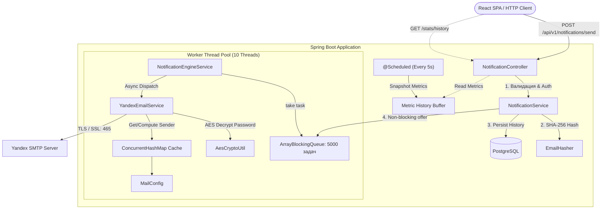

# ⚡ High-Throughput Notification Engine

<p align="center">
  
  
  
  
  
  
  
</p>

<p align="center">
  <b>Высоконагруженный асинхронный сервис пакетной отправки email-уведомлений с кастомным пулом воркеров, динамическим SMTP-контуром, шифрованием секретов и встроенной панелью телеметрии.</b>
</p>

---

## 📌 О проекте

При классической синхронной отправке писем через SMTP HTTP-потоки приложения блокируются ожиданием сетевого ответа внешнего почтового сервера (латентность 500–2500 мс на запрос). При массовой рассылке это приводит к быстрому исчерпанию пула потоков веб-сервера (Tomcat thread starvation) и деградации API.

**High-Throughput Notification Engine** решает эту проблему за счёт изоляции приёма запросов от их фактической доставки:
* Входящие запросы валидируются, сохраняются и мгновенно буферизируются в неблокирующей очереди `ArrayBlockingQueue(5000)`.
* Фиксированный пул из 10 воркеров (`ExecutorService`) параллельно забирает задачи и доставляет их адресатам без задержек для клиента.
* Пароли почтовых ящиков шифруются на уровне приложения алгоритмом AES, а email-адреса получателей хешируются через SHA-256 перед сохранением в историю.
* Весь сервис поставляется как единый артефакт (Single-Artifact Deployment), где React SPA встроен в статические ресурсы Spring Boot.

---

## 🛠 Технологический стек

* **Бэкенд:** Java 21, Spring Boot 3.3.4 (Spring Web, Spring Data JPA, Spring Security, Spring Mail).
* **Многопоточность:** Java Concurrency Utilities (`ExecutorService`, `ArrayBlockingQueue`, `ConcurrentHashMap`, `AtomicLong`).
* **База данных:** PostgreSQL, HikariCP.
* **Безопасность и криптография:** JWT (jjwt 0.12.6), BCrypt, AES-128 (Cipher), SHA-256 (`MessageDigest`).
* **Фронтенд:** React 19, Vite, Recharts, Lucide React.
* **Инфраструктура & Сборка:** Gradle, Docker (Multi-stage build), Cloud Host Render.

---

## 🏗 Архитектура системы



---

## 🚀 Ключевые архитектурные решения

### 1. Неблокирующий конвейер обработки (Producer-Consumer)
HTTP-контроллер принимает пачку адресатов, валидирует принадлежность ящика текущему пользователю и помещает задачи `TaskDTO` в ограниченную очередь `ArrayBlockingQueue` емкостью 5000 элементов. Пул воркеров работает в непрерывном цикле `processQueueLoop`, перехватывая сбои отдельных отправок без остановки общего потока. При переполнении очереди сервис защищён выбросом `QueueOverflow` с кодом `429 Too Many Requests`.

### 2. Динамический транспорт и потокобезопасный кэш SMTP
В отличие от стандартного `JavaMailSender`, привязанного к одному аккаунту в `application.yml`, сервис поддерживает отправку с множества зарегистрированных ящиков. Инстансы `JavaMailSender` конструируются динамически и кэшируются в `ConcurrentHashMap`. При удалении аккаунта кэш точечно сбрасывается методом `clearCacheForUser`.

### 3. Двухконтурная защита данных
* **Персональные данные:** Email-адреса клиентов хешируются (`SHA-256`) перед записью в таблицу истории `notification_table`, исключая утечку клиентской базы при компрометации БД.
* **Секреты интеграций:** Пароли приложений для почтовых ящиков шифруются симметричным алгоритмом `AES-128` компонентом `AesCryptoUtil` перед сохранением в `sender_account`.

### 4. Метрики реального времени и телеметрия
Фоновый шедулер `@Scheduled(fixedRate = 5000)` каждые 5 секунд фиксирует срезы производительности (`currentQueueSize`, `processCount`, `errorsCount`, `throughput`) в кольцевой буфер `ArrayDeque` (глубиной 60 снимков). Графики на фронтенде опрашивают открытый эндпоинт `/stats/history` без создания нагрузки на основную БД.

---

## 📡 Спецификация REST API

### Аутентификация и пользователи
| Метод | Эндпоинт | Доступ | Описание |
| :--- | :--- | :--- | :--- |
| `POST` | `/api/v1/auth/register` | Public | Регистрация нового аккаунта |
| `POST` | `/api/v1/auth/login` | Public | Аутентификация и получение JWT |
| `GET` | `/api/v1/users/me` | User | Получение профиля текущего пользователя |
| `PATCH` | `/api/v1/users/change-password` | User | Смена пароля учетной записи |

### Управление SMTP-отправителями
| Метод | Эндпоинт | Доступ | Описание |
| :--- | :--- | :--- | :--- |
| `GET` | `/api/v1/senders` | User | Список подключенных SMTP-ящиков пользователя |
| `POST` | `/api/v1/senders/register` | User | Привязка и шифрование нового ящика (Яндекс) |
| `GET` | `/api/v1/senders/{id}` | User | Получение информации о конкретном ящике |
| `DELETE` | `/api/v1/senders/{id}` | User | Удаление ящика и инвалидация его SMTP-кэша |

### Движок рассылок и телеметрия
| Метод | Эндпоинт | Доступ | Описание |
| :--- | :--- | :--- | :--- |
| `POST` | `/api/v1/notifications/send` | User | Постановка рассылки (одиночной/пакетной) в очередь |
| `GET` | `/api/v1/notifications/stats` | Public | Текущие live-показатели очереди и ошибок |
| `GET` | `/api/v1/notifications/stats/history` | Public | История срезов Throughput для графиков |
| `GET` | `/api/v1/notifications/history` | User | Аудит-лог отправленных писем (с хешированными email) |
| `GET` | `/api/v1/health` | Public | Проверка жизнеспособности сервера (Health check) |

---

## 💻 Локальный запуск

### 1. Требования
* JDK 21
* Node.js 20+ и npm
* PostgreSQL 15+

### 2. Клонирование репозитория
```bash
git clone https://github.com/sankyqdi/High-Throughput-Notification-Engine.git
cd High-Throughput-Notification-Engine
```

### 3. Переменные окружения
Создайте файл `.env` или экспортируйте переменные в терминале:
```bash
export SPRING_DATASOURCE_URL="jdbc:postgresql://localhost:5432/notification_db"
export SPRING_DATASOURCE_USERNAME="postgres"
export SPRING_DATASOURCE_PASSWORD="your_password"
export JWT_SECRET="v9y$B&E)H@McQfTjWnZr4u7x!A%C*F-JaNdRgUkXp2s5v8y/B?E(G+KbPeShVmYq"
export CRYPTO_AES_SECRET_KEY="16BytesSecretKey"
```

### 4. Сборка фронтенда
```bash
cd frontend
npm install
npm run build
cd ..
```

### 5. Запуск Spring Boot
```bash
./app/gradlew clean bootRun --project-dir app
```

Приложение и веб-интерфейс будут доступны по адресу: `http://localhost:8080`.

---

## 🐳 Сборка в Docker (Multi-stage)

Сборка React SPA и упаковка Spring Boot fat-jar выполняются автоматически внутри единого изолированного контейнера:

```bash
docker build -t notification-engine .
docker run -p 8080:8080 \
  -e SPRING_DATASOURCE_URL="jdbc:postgresql://host.docker.internal:5432/notification_db" \
  -e SPRING_DATASOURCE_USERNAME="postgres" \
  -e SPRING_DATASOURCE_PASSWORD="password" \
  -e JWT_SECRET="v9y$B&E)H@McQfTjWnZr4u7x!A%C*F-JaNdRgUkXp2s5v8y/B?E(G+KbPeShVmYq" \
  -e CRYPTO_AES_SECRET_KEY="16BytesSecretKey" \
  notification-engine
```

---

## 🧪 Тестирование

Проект покрыт юнит- и интеграционными тестами с использованием Mockito, AssertJ и Spring Security Test:
```bash
./app/gradlew test --project-dir app
```

* `NotificationEngineServiceTest` — проверка работы блокирующей очереди, обработки сбоев SMTP, graceful shutdown пула и конкурентной изоляции.
* `NotificationControllerTest` — интеграционные тесты контроллеров с проверкой валидации DTO (`@Valid`, `@Size`, `@Email`).
* `SecurityIntegrationTest` — сквозные тесты фильтрации JWT, разграничения публичных и защищенных маршрутов.